<p align="center">
  
</p>

<p align="center">
  <a href="https://github.com/WhoSowSee/mdv/graphs/contributors"></a>
  <a href="https://github.com/WhoSowSee/mdv/forks"></a>
  <a href="https://github.com/WhoSowSee/mdv/stargazers"></a>
</p>

<p align="center">
  <a href="https://crates.io/crates/mdv"></a>
  <a href="https://crates.io/crates/mdv"></a>
</p>

<h2 align="center">Быстрый и настраиваемый просмотрщик Markdown для терминала</h2>

<p align="center">
  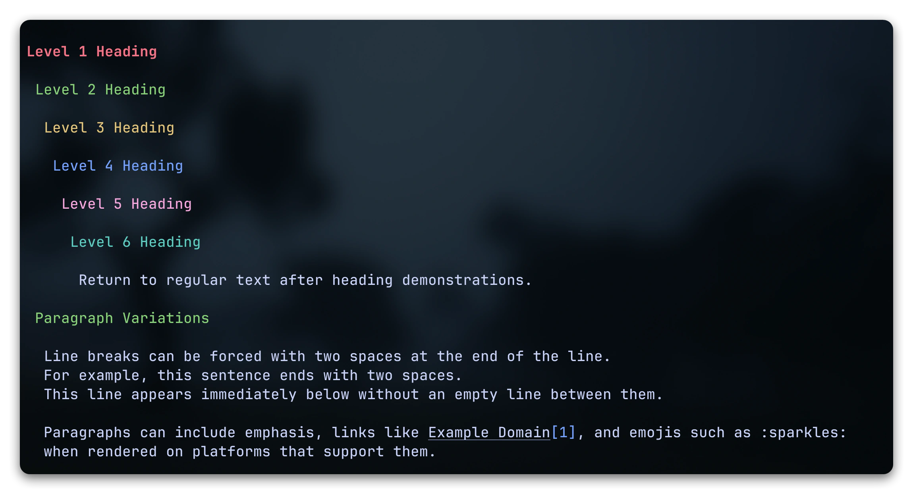
</p>

> [!TIP]
> **English version:** [README.md](README.md)

> [!NOTE]
> mdv - терминальная утилита для точного рендеринга Markdown в ANSI-совместимых терминалах. В её арсенале:
>
> - **Рендеринг для терминала** - Подсветка синтаксиса, опциональный HTML-вывод и аккуратная работа с инлайновым форматированием.
> - **Гибкие схемы верстки** - Управляйте шириной, стратегией переноса, отступами заголовков и поведением таблиц под ваш терминал.
> - **Контроль ссылок** - Переключайтесь между кликабельными, инлайн- и табличными ссылками, выбирайте перенос, обрезку или переполнение длинных URL.
> - **Расширенное тематизирование** - Встроенные палитры и моментальные переопределения цветов интерфейса и подсветки кода.
> - **Живой мониторинг** - Следите за файлами с `--monitor`, чтобы видеть обновления сразу после сохранения.
> - **CLI, удобный для скриптов** - Чтение из stdin, прыжки к разделам через `--from`, перенос конфигурации между машинами.

## Установка

**Cargo.** Требуется Rust 1.95 или новее.

```sh
cargo install mdv
```

**macOS и Linux.** Поддерживаются x86_64 и ARM64.

```sh
curl -fsSL https://whosowsee.github.io/mdv/install.sh | sh
```

**Windows.** PowerShell 5.1 или PowerShell 7 на x64 и ARM64.

```powershell
irm https://whosowsee.github.io/mdv/install.ps1 | iex
```

Скрипты скачивают последний релиз GitHub и проверяют SHA-256. Rust не нужен. Для обновления повторите ту же команду.

Установка RPM и пакетов Arch Linux, Nix, сборка из исходников, выбор версии и удаление описаны в [руководстве по установке](https://whosowsee.github.io/mdv/ru/docs/installation/).

## Быстрый старт

```sh
mdv README-RU.md                     # Открыть Markdown-файл
mdv --theme catppuccin README-RU.md  # Выбрать тему
mdv --preset reader README-RU.md     # Применить пресет
mdv --monitor README-RU.md           # Обновлять вывод при изменении файла
mdv -i                               # Выбрать Markdown-файл в текущем каталоге
cat notes.md | mdv                   # Прочитать Markdown из конвейера
```

Команда `mdv --help` выводит полный список параметров.

## Конфигурация

Создайте файл конфигурации командой `mdv --init-config`. Параметры CLI имеют наивысший приоритет, далее идут пресет `--preset`, файл конфигурации и встроенные значения. Для настройки `color` переменная `MDV_COLOR` имеет приоритет над пресетом и файлом конфигурации.

Встроенные темы включают `terminal` (по умолчанию), `solarized-dark`, `nord`, `tokyonight`, `kanagawa`, `gruvbox`, `monokai`, `material-ocean` и `catppuccin`. Встроенные пресеты включают `reader`, `compact`, `pretty` и `showcase`. Пользовательские темы и пресеты хранятся в YAML-файлах в каталоге конфигурации. Превью и форматы файлов описаны в разделах [«Темы»](https://whosowsee.github.io/mdv/ru/docs/themes/) и [«Пресеты»](https://whosowsee.github.io/mdv/ru/docs/presets/).

## Темы

<details>
  <summary><code>terminal</code></summary>

  <div style="text-align: center;">
    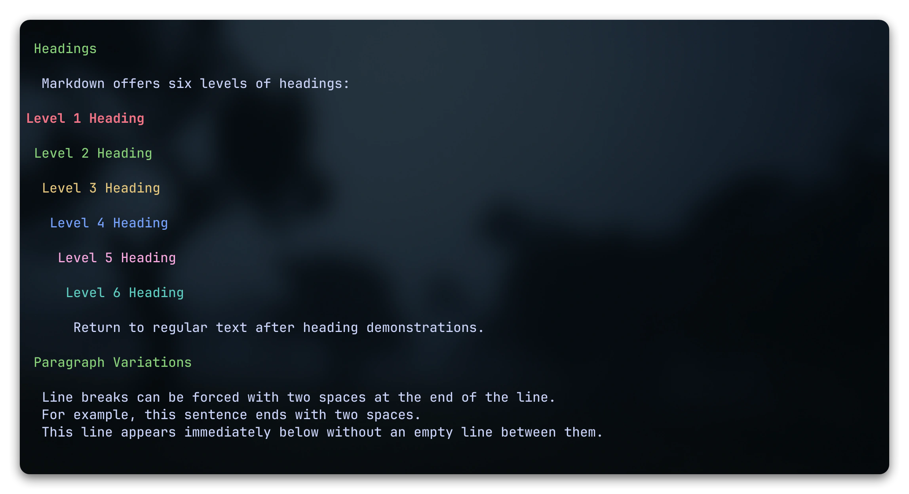
  </div>
  <div style="text-align: center;">
    
  </div>
  <div style="text-align: center;">
    
  </div>
</details>

<details>
  <summary><code>monokai</code></summary>

  <div style="text-align: center;">
    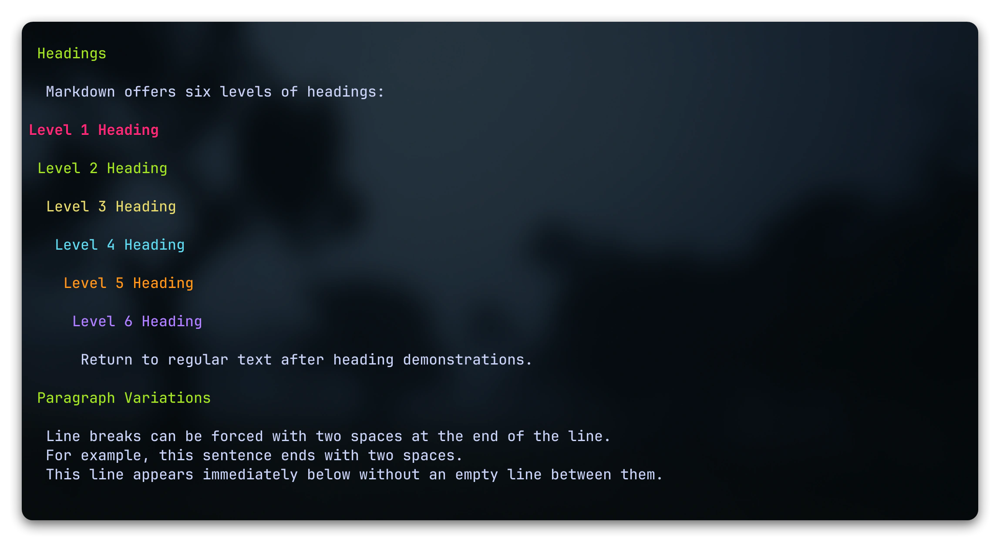
  </div>
  <div style="text-align: center;">
    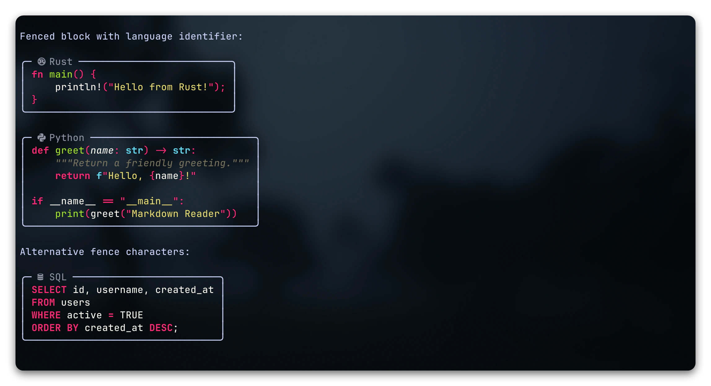
  </div>
  <div style="text-align: center;">
    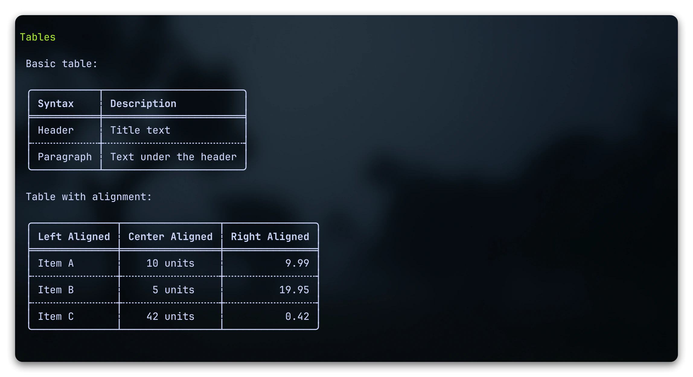
  </div>
</details>

<details>
  <summary><code>solarized-dark</code></summary>

  <div style="text-align: center;">
    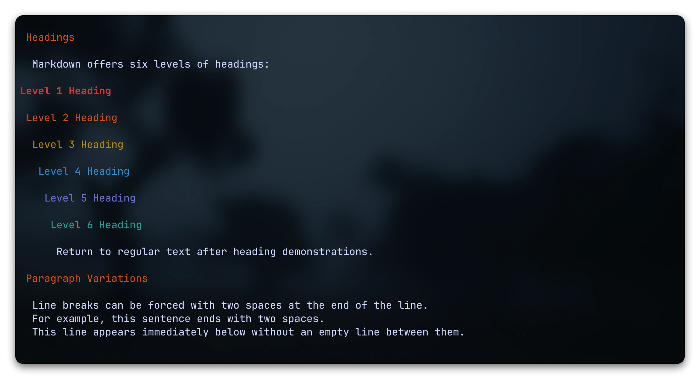
  </div>
  <div style="text-align: center;">
    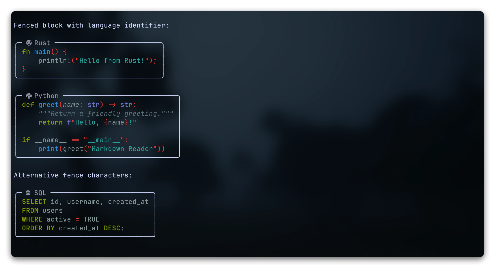
  </div>
  <div style="text-align: center;">
    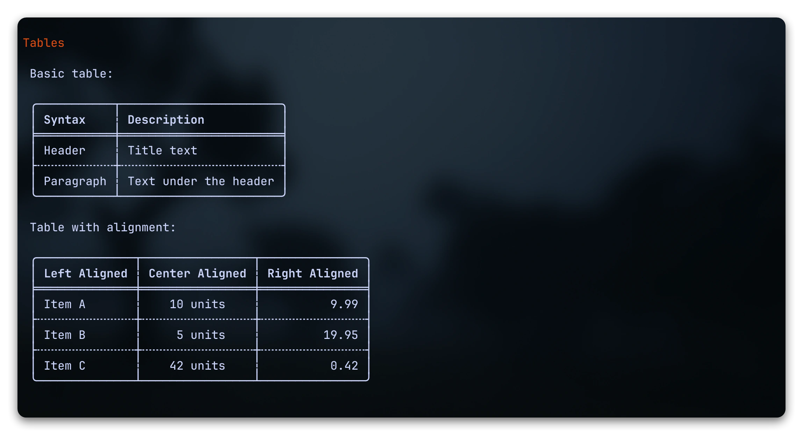
  </div>
</details>

<details>
  <summary><code>nord</code></summary>

  <div style="text-align: center;">
    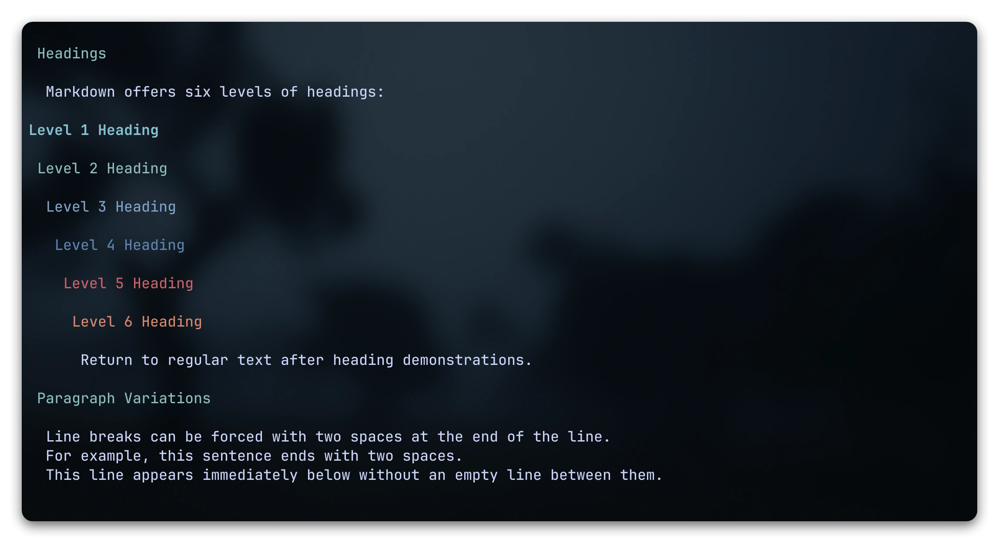
  </div>
  <div style="text-align: center;">
    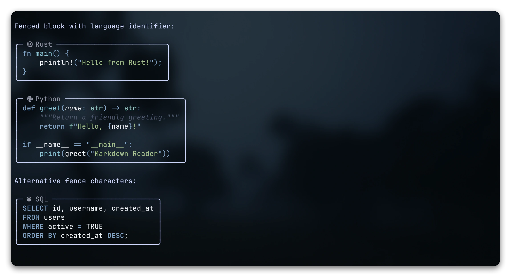
  </div>
  <div style="text-align: center;">
    
  </div>
</details>

<details>
  <summary><code>tokyonight</code></summary>

  <div style="text-align: center;">
    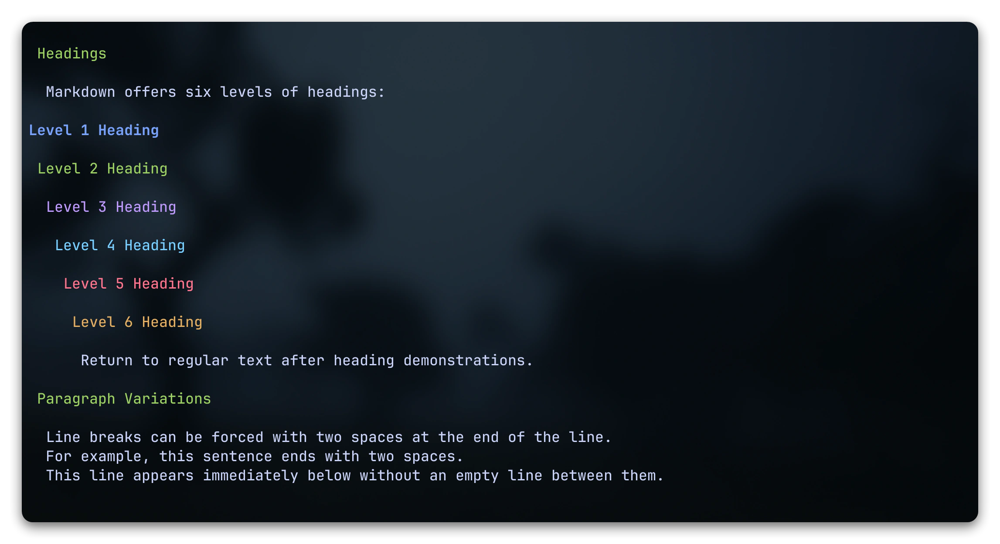
  </div>
  <div style="text-align: center;">
    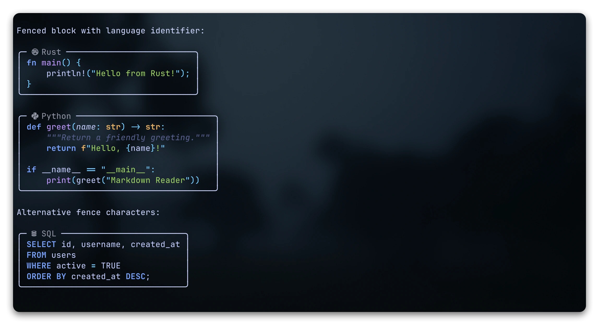
  </div>
  <div style="text-align: center;">
    
  </div>
</details>

<details>
  <summary><code>kanagawa</code></summary>

  <div style="text-align: center;">
    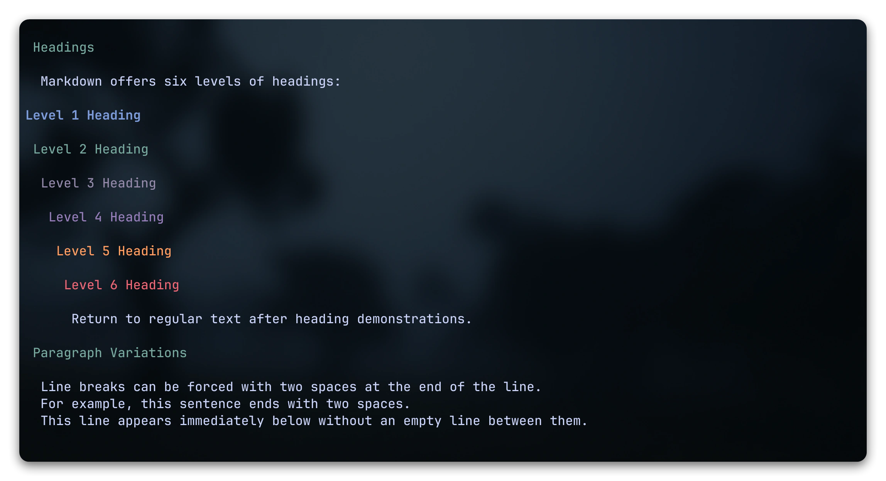
  </div>
  <div style="text-align: center;">
    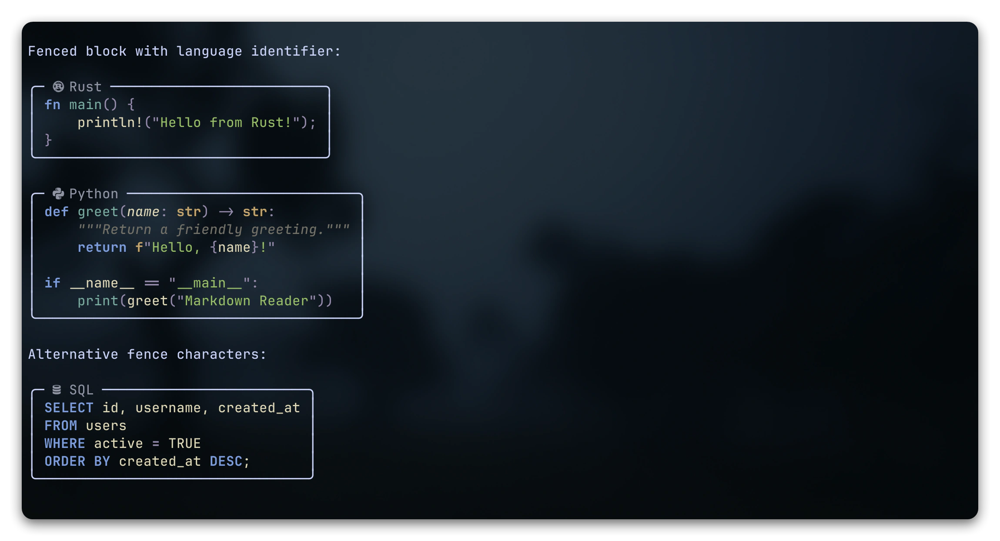
  </div>
  <div style="text-align: center;">
    
  </div>
</details>

<details>
  <summary><code>gruvbox</code></summary>

  <div style="text-align: center;">
    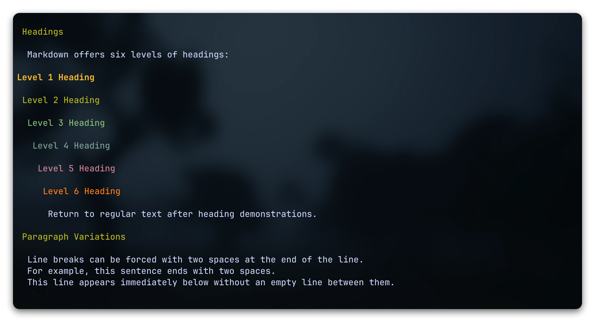
  </div>
  <div style="text-align: center;">
    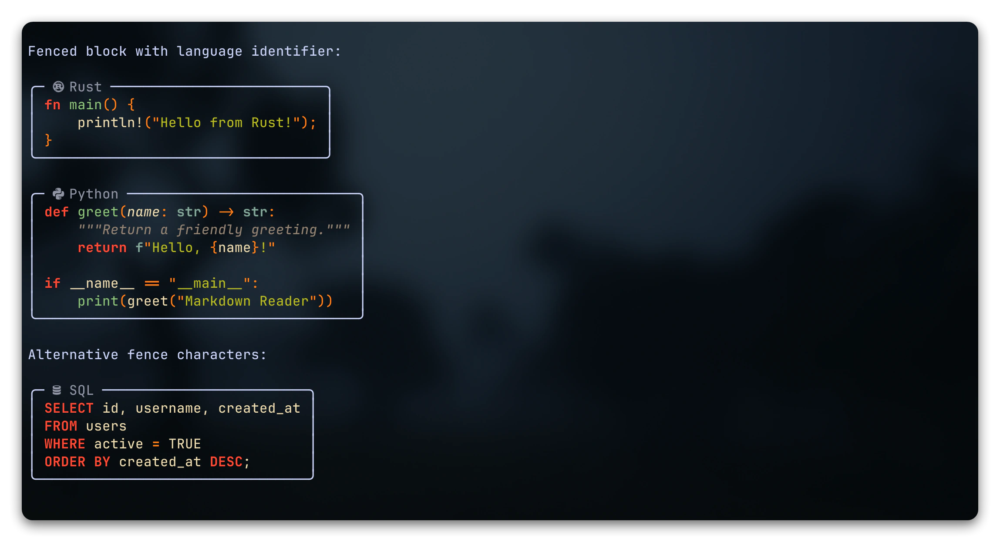
  </div>
  <div style="text-align: center;">
    
  </div>
</details>

<details>
  <summary><code>material-ocean</code></summary>

  <div style="text-align: center;">
    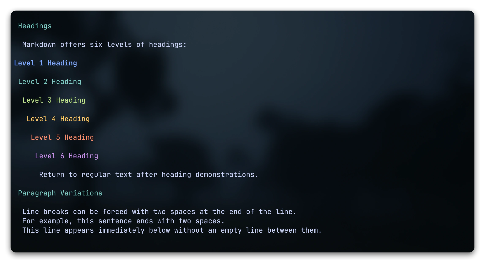
  </div>
  <div style="text-align: center;">
    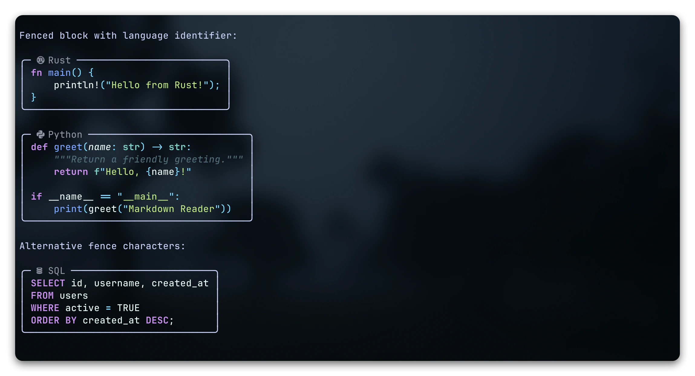
  </div>
  <div style="text-align: center;">
    
  </div>
</details>

<details>
  <summary><code>catppuccin</code></summary>

  <div style="text-align: center;">
    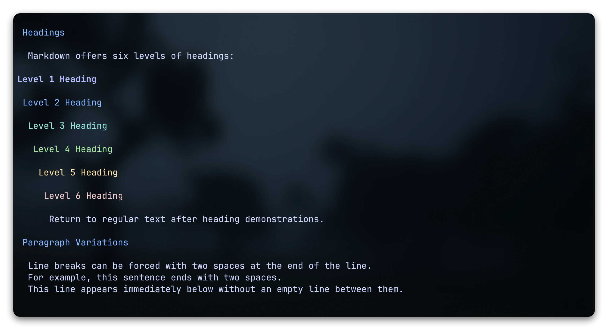
  </div>
  <div style="text-align: center;">
    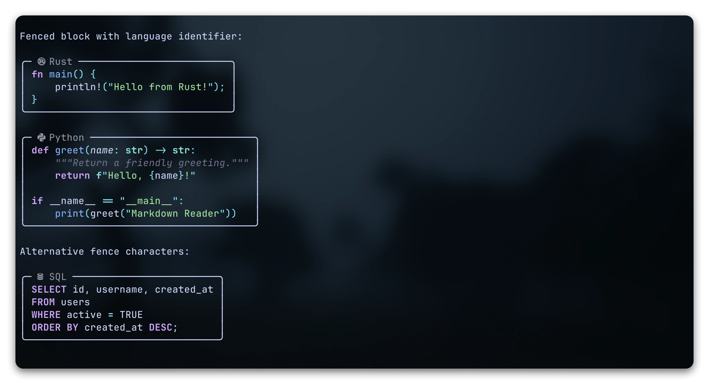
  </div>
  <div style="text-align: center;">
    
  </div>
</details>

## Документация

Полная документация доступна на [сайте проекта](https://whosowsee.github.io/mdv/ru/docs/) ([English](https://whosowsee.github.io/mdv/docs/)).

- **Начало работы** · [Введение](https://whosowsee.github.io/mdv/ru/docs/), [Установка](https://whosowsee.github.io/mdv/ru/docs/installation/), [Использование](https://whosowsee.github.io/mdv/ru/docs/usage/)
- **Чтение** · [Выбор документов](https://whosowsee.github.io/mdv/ru/docs/browser/), [Просмотр и редактор](https://whosowsee.github.io/mdv/ru/docs/pager/), [Обновление на лету](https://whosowsee.github.io/mdv/ru/docs/monitoring/)
- **Оформление** · [Разметка и переносы](https://whosowsee.github.io/mdv/ru/docs/rendering/), [Блоки кода](https://whosowsee.github.io/mdv/ru/docs/code-blocks/), [Математика](https://whosowsee.github.io/mdv/ru/docs/math/), [Выноски](https://whosowsee.github.io/mdv/ru/docs/callouts/), [Списки и чекбоксы](https://whosowsee.github.io/mdv/ru/docs/lists/), [Ссылки и сноски](https://whosowsee.github.io/mdv/ru/docs/links/), [Front matter](https://whosowsee.github.io/mdv/ru/docs/front-matter/), [HTML](https://whosowsee.github.io/mdv/ru/docs/html/)
- **Настройка** · [Темы](https://whosowsee.github.io/mdv/ru/docs/themes/), [Поля темы](https://whosowsee.github.io/mdv/ru/docs/theme-reference/), [Пресеты](https://whosowsee.github.io/mdv/ru/docs/presets/), [Свои синтаксисы](https://whosowsee.github.io/mdv/ru/docs/syntaxes/)
- **Справочники** · [Конфигурация](https://whosowsee.github.io/mdv/ru/docs/configuration/), [Справочник YAML](https://whosowsee.github.io/mdv/ru/docs/configuration-reference/), [Переменные окружения](https://whosowsee.github.io/mdv/ru/docs/environment/), [Полный справочник CLI](https://whosowsee.github.io/mdv/ru/docs/cli/)

## Разработка

Как сообщить о проблеме и подготовить pull request, описано в [CONTRIBUTING.md](CONTRIBUTING.md). Для изменений с помощью ИИ действуют правила [AI Policy](AI_POLICY.md). Инструменты, команды `just`, тесты, CI и исходники сайта описаны в [руководстве по разработке](https://whosowsee.github.io/mdv/ru/docs/development/).

---

<p align="center">
  <a href="https://github.com/WhoSowSee/mdv/stargazers">
    <picture>
      <source
        media="(prefers-color-scheme: dark)"
        srcset="https://raw.githubusercontent.com/WhoSowSee/mdv/main/.github/assets/star-history-dark-ru.svg"
      />
      <source
        media="(prefers-color-scheme: light)"
        srcset="https://raw.githubusercontent.com/WhoSowSee/mdv/main/.github/assets/star-history-light-ru.svg"
      />
      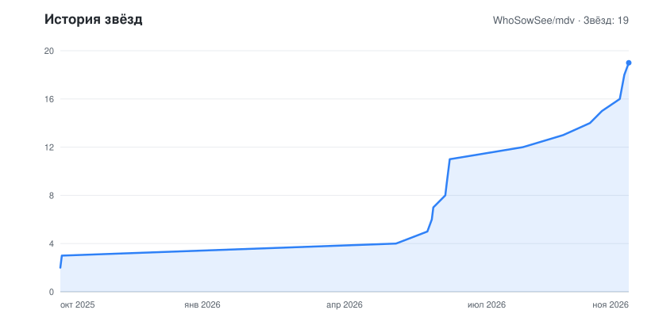
    </picture>
  </a>
</p>

<p align="center">
  
</p>

<p align="center">
  <i><code>&copy 2026-present <a href="https://github.com/WhoSowSee">WhoSowSee</a></code></i>
</p>

<p align="center">
  <a href="https://github.com/WhoSowSee/mdv/blob/main/LICENSE"></a>
</p>
