<p align="center">
  
</p>

<p align="center">
  <a href="https://github.com/WhoSowSee/mdv/graphs/contributors"></a>
  <a href="https://github.com/WhoSowSee/mdv/forks"></a>
  <a href="https://github.com/WhoSowSee/mdv/stargazers"></a>
</p>

<p align="center">
  <a href="https://crates.io/crates/mdv"></a>
  <a href="https://crates.io/crates/mdv"></a>
</p>

<h2 align="center">Fast, themeable Markdown viewer for the terminal</h2>

<p align="center">
  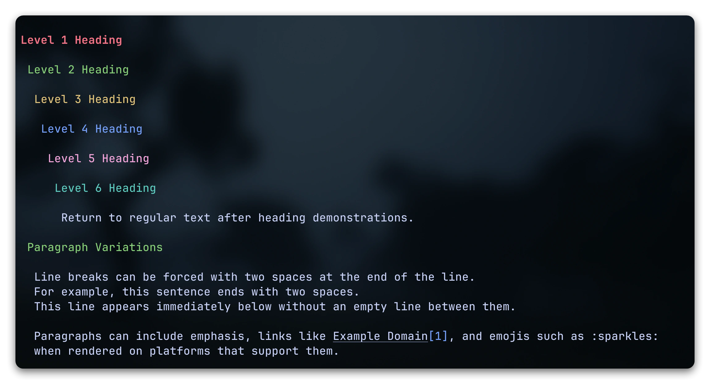
</p>

> [!TIP]
> **Русская версия:** [README-RU.md](README-RU.md)

> [!NOTE]
> mdv is a terminal Markdown viewer focused on precise rendering inside ANSI-capable terminals. It offers:
>
> - **Terminal-first rendering** - Syntax highlighted output, optional HTML export, and careful handling of inline formatting.
> - **Reusable layouts** - Control width, wrapping strategy, heading indentation, and table behavior to match your workspace.
> - **Link presentation control** - Switch between clickable, inline, or tabular links and choose how URLs wrap, shorten, or overflow.
> - **Rich theming** - Built-in color schemes plus on-the-fly overrides for UI and syntax palettes.
> - **Live monitoring** - Watch files with `--monitor` to refresh the view whenever the source changes.
> - **Script friendly CLI** - Read from stdin, jump to sections with `--from`, and share configuration files across machines.

## Installation

**Cargo.** Requires Rust 1.95 or newer.

```sh
cargo install mdv
```

**macOS and Linux.** Supports x86_64 and ARM64.

```sh
curl -fsSL https://whosowsee.github.io/mdv/install.sh | sh
```

**Windows.** PowerShell 5.1 or PowerShell 7 on x64 and ARM64.

```powershell
irm https://whosowsee.github.io/mdv/install.ps1 | iex
```

The scripts download the latest GitHub release and verify its SHA-256 digest. Rust is not required. Run the same command to update.

See the [installation guide](https://whosowsee.github.io/mdv/docs/installation/) for RPM and Arch Linux packages, Nix, source builds, version selection and removal.

## Quick start

```sh
mdv README.md                     # render a file
mdv --theme catppuccin README.md  # choose a theme
mdv --preset reader README.md     # apply a preset
mdv --monitor README.md           # re-render when the file changes
mdv -i                            # browse Markdown files in the current directory
cat notes.md | mdv                # read from a pipe
```

Run `mdv --help` for the full option list.

## Configuration

Create a configuration file with `mdv --init-config`. CLI options have highest priority, followed by the `--preset` selection, the configuration file and built-in defaults. For `color`, `MDV_COLOR` takes priority over the preset and configuration file.

The built-in themes are `terminal` (default), `solarized-dark`, `nord`, `tokyonight`, `kanagawa`, `gruvbox`, `monokai`, `material-ocean` and `catppuccin`. The built-in presets are `reader`, `compact`, `pretty` and `showcase`. User themes and presets are YAML files in the configuration directory. See [Themes](https://whosowsee.github.io/mdv/docs/themes/) and [Presets](https://whosowsee.github.io/mdv/docs/presets/) for previews and file formats.

## Themes

<details>
  <summary><code>terminal</code></summary>

  <div style="text-align: center;">
    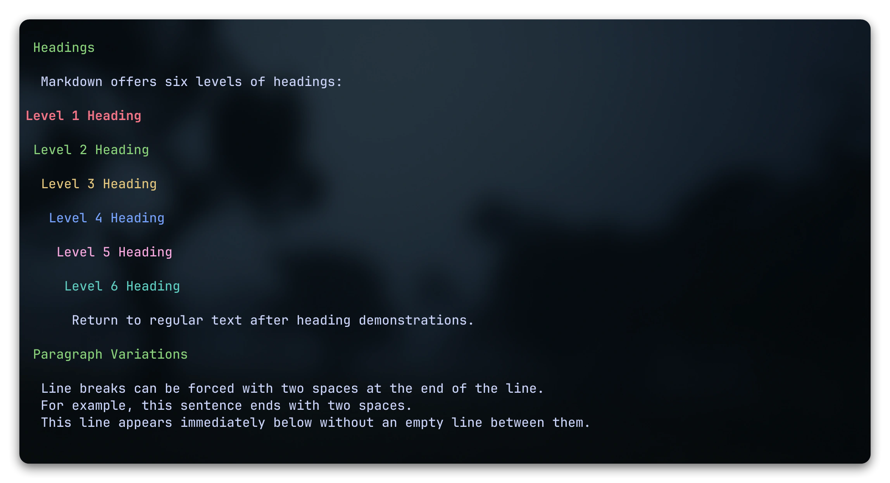
  </div>
  <div style="text-align: center;">
    
  </div>
  <div style="text-align: center;">
    
  </div>
</details>

<details>
  <summary><code>monokai</code></summary>

  <div style="text-align: center;">
    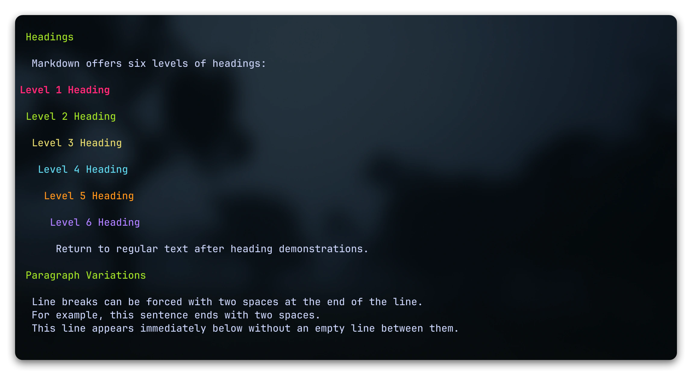
  </div>
  <div style="text-align: center;">
    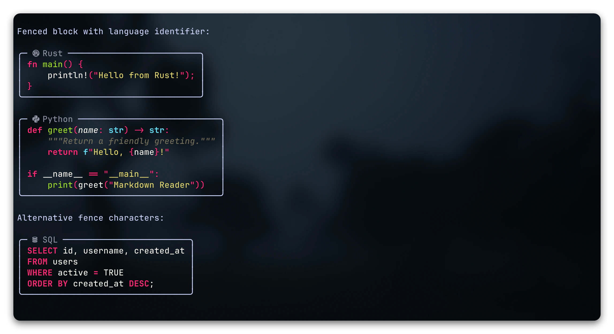
  </div>
  <div style="text-align: center;">
    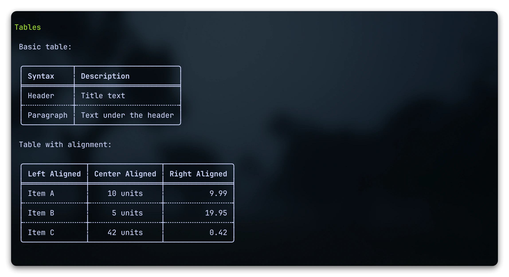
  </div>
</details>

<details>
  <summary><code>solarized-dark</code></summary>

  <div style="text-align: center;">
    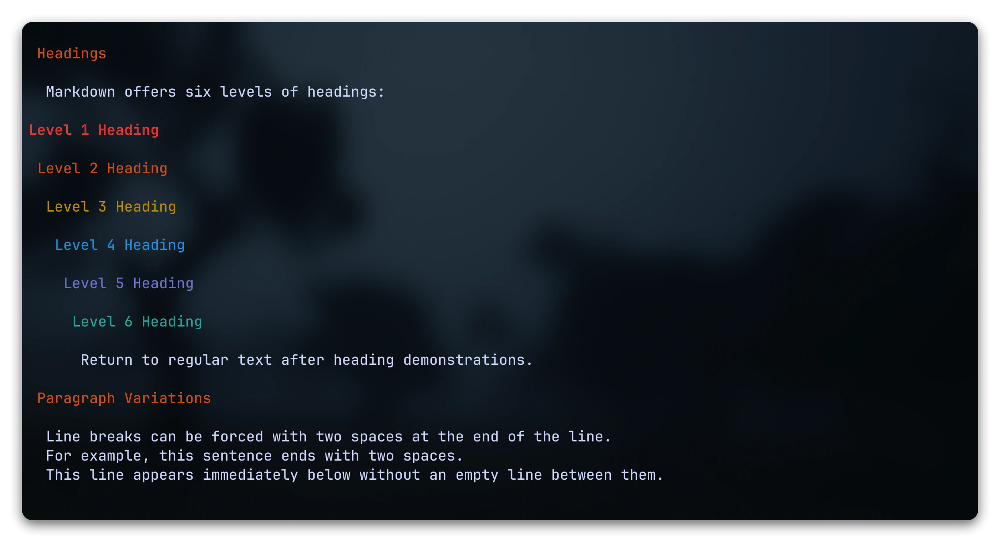
  </div>
  <div style="text-align: center;">
    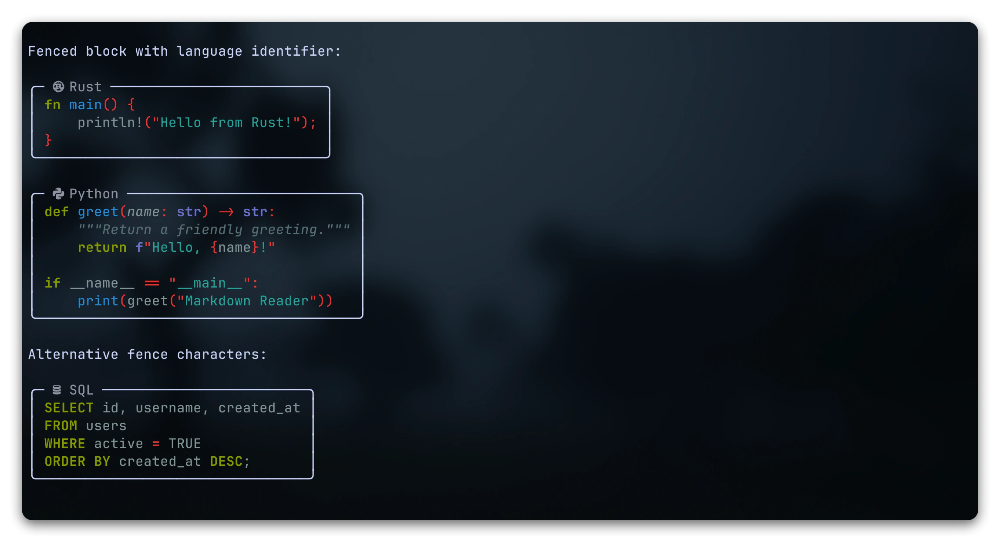
  </div>
  <div style="text-align: center;">
    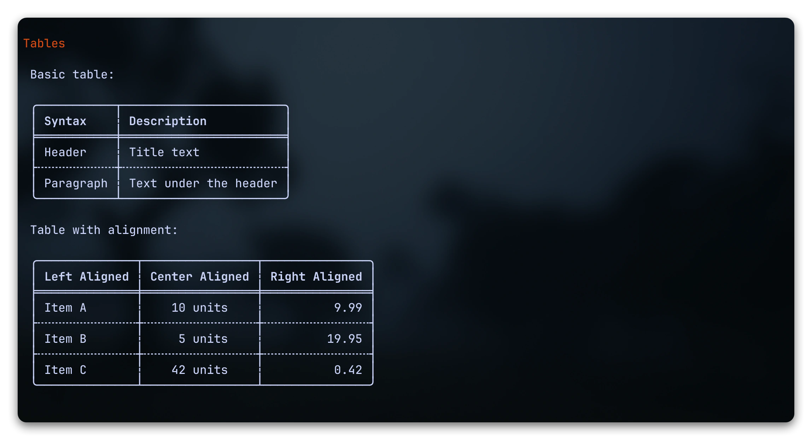
  </div>
</details>

<details>
  <summary><code>nord</code></summary>

  <div style="text-align: center;">
    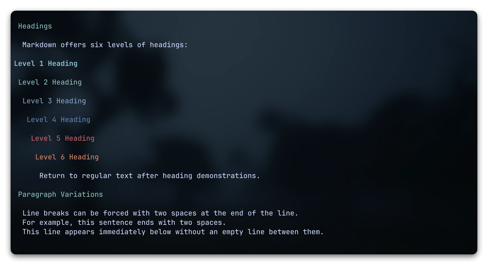
  </div>
  <div style="text-align: center;">
    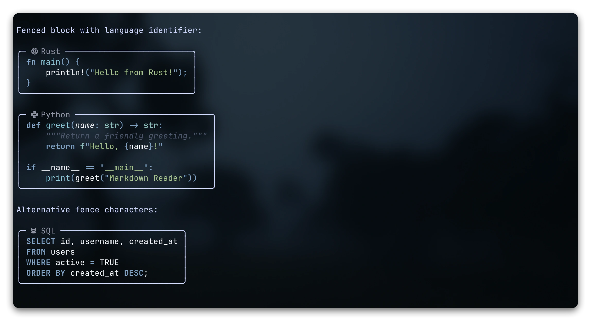
  </div>
  <div style="text-align: center;">
    
  </div>
</details>

<details>
  <summary><code>tokyonight</code></summary>

  <div style="text-align: center;">
    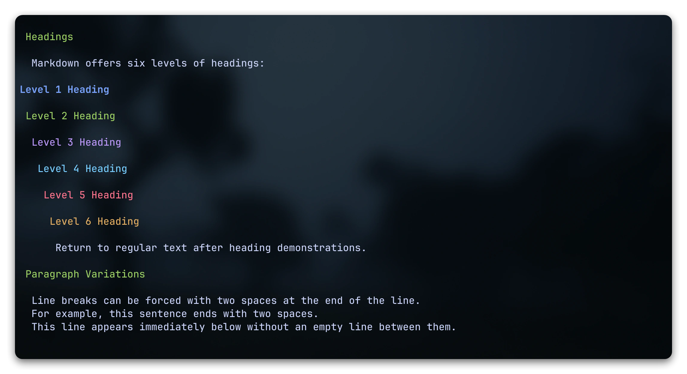
  </div>
  <div style="text-align: center;">
    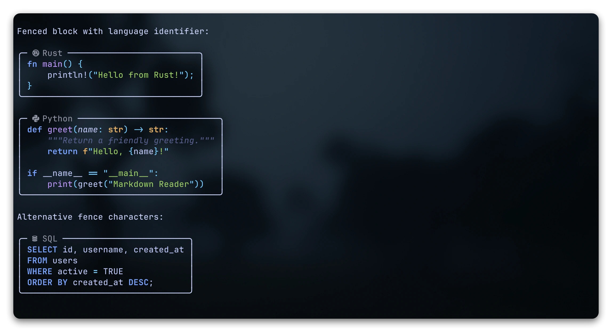
  </div>
  <div style="text-align: center;">
    
  </div>
</details>

<details>
  <summary><code>kanagawa</code></summary>

  <div style="text-align: center;">
    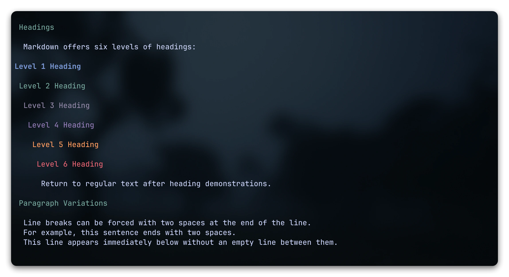
  </div>
  <div style="text-align: center;">
    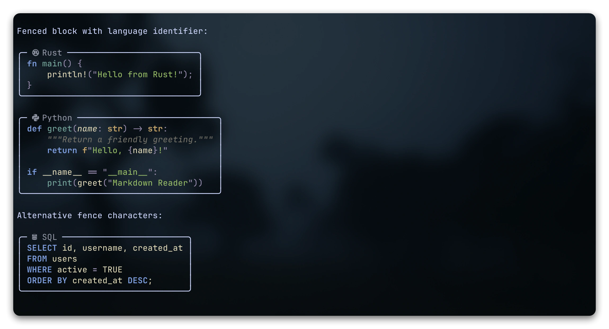
  </div>
  <div style="text-align: center;">
    
  </div>
</details>

<details>
  <summary><code>gruvbox</code></summary>

  <div style="text-align: center;">
    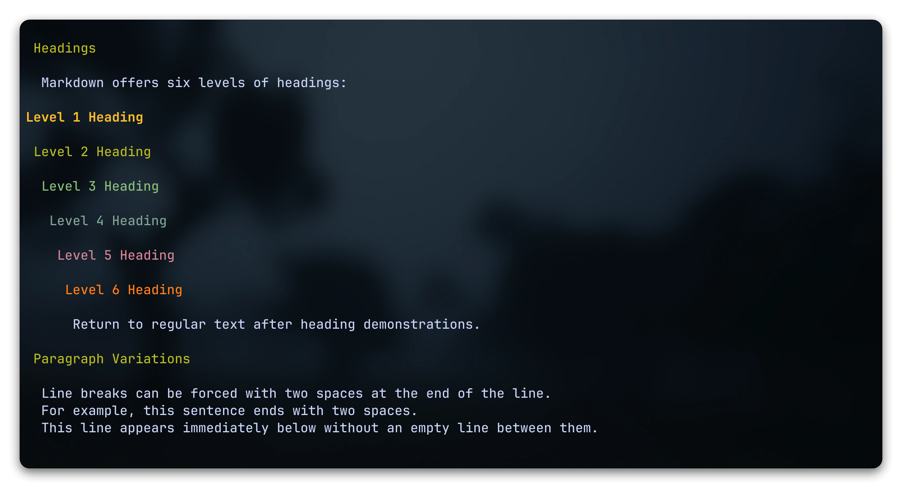
  </div>
  <div style="text-align: center;">
    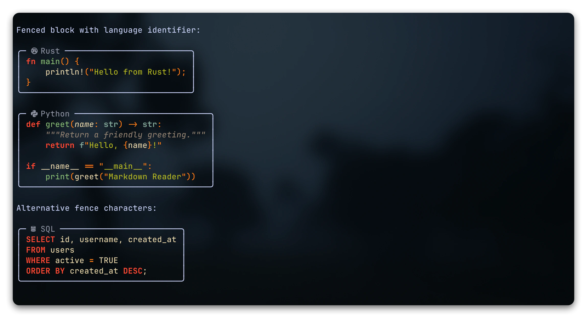
  </div>
  <div style="text-align: center;">
    
  </div>
</details>

<details>
  <summary><code>material-ocean</code></summary>

  <div style="text-align: center;">
    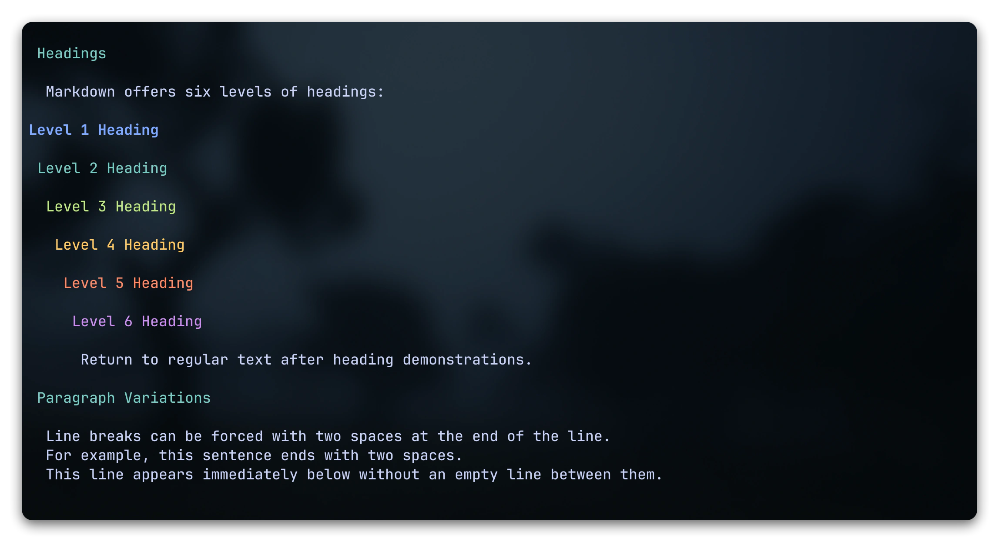
  </div>
  <div style="text-align: center;">
    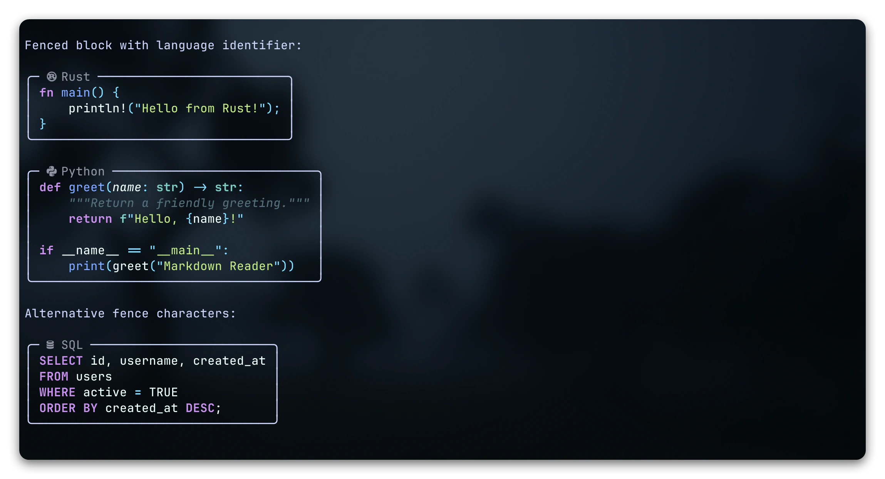
  </div>
  <div style="text-align: center;">
    
  </div>
</details>

<details>
  <summary><code>catppuccin</code></summary>

  <div style="text-align: center;">
    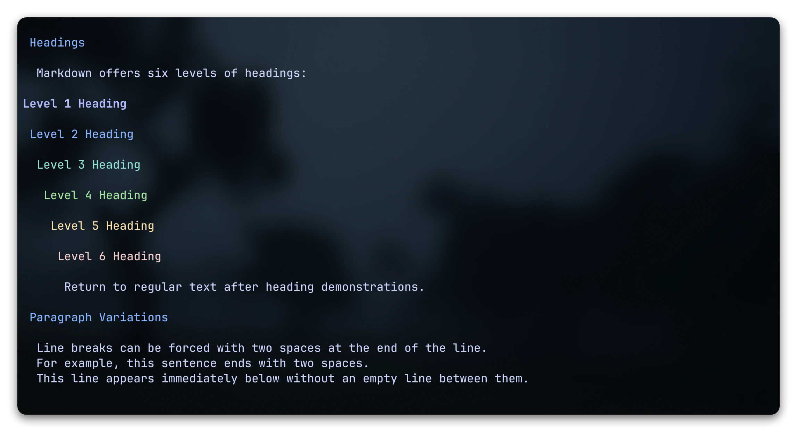
  </div>
  <div style="text-align: center;">
    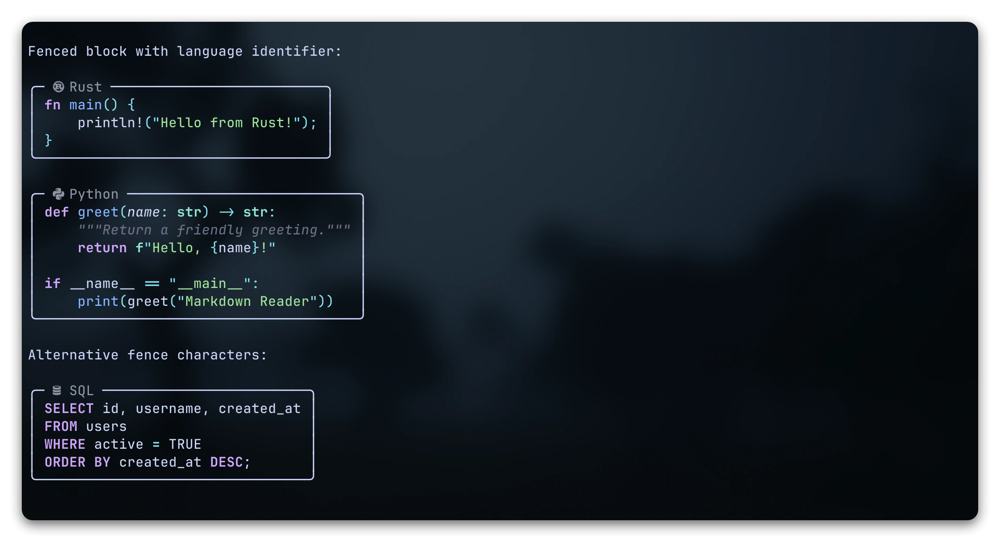
  </div>
  <div style="text-align: center;">
    
  </div>
</details>

## Documentation

Full documentation is on the [project website](https://whosowsee.github.io/mdv/docs/) ([Русский](https://whosowsee.github.io/mdv/ru/docs/)).

- **Getting started** · [Introduction](https://whosowsee.github.io/mdv/docs/), [Installation](https://whosowsee.github.io/mdv/docs/installation/), [Usage](https://whosowsee.github.io/mdv/docs/usage/)
- **Reading** · [Document browser](https://whosowsee.github.io/mdv/docs/browser/), [Pager and editor](https://whosowsee.github.io/mdv/docs/pager/), [Live monitoring](https://whosowsee.github.io/mdv/docs/monitoring/)
- **Formatting** · [Layout and wrapping](https://whosowsee.github.io/mdv/docs/rendering/), [Code blocks](https://whosowsee.github.io/mdv/docs/code-blocks/), [Math](https://whosowsee.github.io/mdv/docs/math/), [Callouts](https://whosowsee.github.io/mdv/docs/callouts/), [Lists and checkboxes](https://whosowsee.github.io/mdv/docs/lists/), [Links and footnotes](https://whosowsee.github.io/mdv/docs/links/), [Front matter](https://whosowsee.github.io/mdv/docs/front-matter/), [HTML](https://whosowsee.github.io/mdv/docs/html/)
- **Customization** · [Themes](https://whosowsee.github.io/mdv/docs/themes/), [Theme field reference](https://whosowsee.github.io/mdv/docs/theme-reference/), [Presets](https://whosowsee.github.io/mdv/docs/presets/), [Custom syntaxes](https://whosowsee.github.io/mdv/docs/syntaxes/)
- **Reference** · [Configuration](https://whosowsee.github.io/mdv/docs/configuration/), [YAML reference](https://whosowsee.github.io/mdv/docs/configuration-reference/), [Environment variables](https://whosowsee.github.io/mdv/docs/environment/), [Complete CLI reference](https://whosowsee.github.io/mdv/docs/cli/)

## Development

See [CONTRIBUTING.md](CONTRIBUTING.md) for issues and pull requests, and the [AI Policy](AI_POLICY.md) for AI-assisted contributions. The toolchain, `just` commands, tests, CI and the website sources are described in the [development guide](https://whosowsee.github.io/mdv/docs/development/).

---

<p align="center">
  <a href="https://github.com/WhoSowSee/mdv/stargazers">
    <picture>
      <source
        media="(prefers-color-scheme: dark)"
        srcset="https://raw.githubusercontent.com/WhoSowSee/mdv/main/.github/assets/star-history-dark.svg"
      />
      <source
        media="(prefers-color-scheme: light)"
        srcset="https://raw.githubusercontent.com/WhoSowSee/mdv/main/.github/assets/star-history-light.svg"
      />
      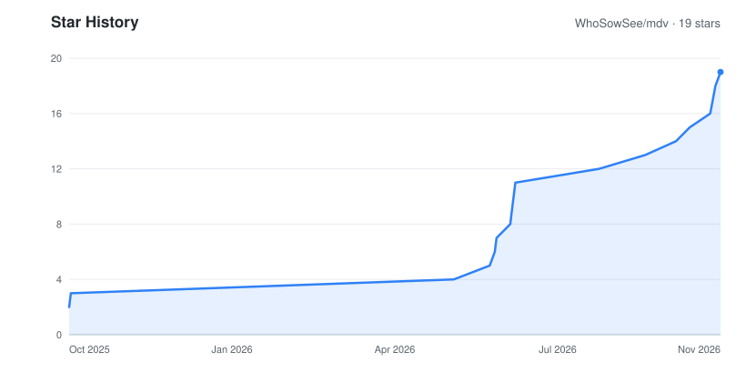
    </picture>
  </a>
</p>

<p align="center">
  
</p>

<p align="center">
  <i><code>&copy 2026-present <a href="https://github.com/WhoSowSee">WhoSowSee</a></code></i>
</p>

<p align="center">
  <a href="https://github.com/WhoSowSee/mdv/blob/main/LICENSE"></a>
</p>
