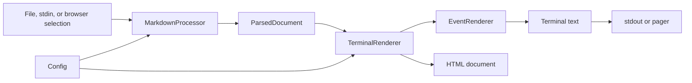

# Architecture

mdv is a Rust package with a CLI entry point and a library API. It parses Markdown into
owned events and renders them as terminal text or an HTML document.

## Component boundaries

- The application selects input, execution mode, and output destination.
- Configuration assembly resolves CLI, YAML, presets, and environment values into `Config`.
- `MarkdownProcessor` extracts front matter, normalizes syntax, and preserves source positions.
- `TerminalRenderer` owns themes and syntax resources. Its `EventRenderer` manages the state
  of one terminal-rendering pass.
- The browser, pager, and monitor reuse document rendering through callbacks.

See the [file index](file-index.md) for implementation locations and
[application routing](application.md#mode-selection) for execution modes.

## Document flow

`ParsedDocument` owns front matter and `Vec<Event<'static>>`, allowing input storage to be
released independently. Rendering passes borrow this event stream. The terminal and HTML
backends consume parsed content independently; HTML export does not parse ANSI output.

## State ownership

| State | Owner | Contract |
|---|---|---|
| Effective settings | `Config` | Renderers receive validated settings without re-reading CLI or YAML. |
| Source transformations | `MarkdownProcessor` | Every transformation preserves the source-line map. |
| Themes and syntaxes | `TerminalRenderer` | Resources are reused across layouts and refreshes. |
| Open Markdown elements | `EventRenderer` | Nested handlers share one rendering pass and its reference scopes. |
| Paged document and cached views | `RwLock<PagerDocument>` | Refresh installs source, output, and navigation data as one document. |
| Browser selection and discovery | `BrowserState` | Results can arrive while filtering and navigation remain available. |

## Rendering contracts

Visible widths exclude ANSI and OSC sequences and use Unicode display columns. Source-line
markers occupy no columns and are removed before final output. Table layout receives plain
cell content; link styling is restored after geometry is calculated.

Event handlers share renderer-owned state within `renderer::event`. Deferred references,
footnotes, and buffered containers finish at their owning block or document boundary.
Changes to output spacing must keep the saved positions of open blocks valid.

Ordinary output, monitor refreshes, and pager views use the same document pipeline.
The [pager](interactive-and-pager.md#selection-and-copying) copies selected rendered text;
without a selection, copy commands leave the clipboard unchanged.

Configuration, source normalization, and rendering remain separate responsibilities:
`markdown` depends on `Config`, while `renderer` also uses themes, tables, terminal styles,
and width utilities. Interactive adapters own terminal sessions and file watching.
